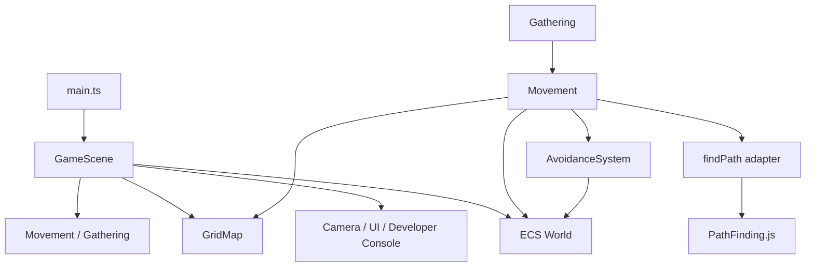

# KingdomRise 当前架构

本文记录代码能够证明的当前架构。路线图能力单独标为“规划”，已有接口但缺少实际实现的能力标为“预留”，证据不足的设计标为“待确认”。模块职责和扩展规则见 [module-boundaries.md](module-boundaries.md)，重要取舍见 [decisions](decisions/README.md)。

审查基线：2026-10-13 的当前工作树，包含尚未提交的移动安全校验、摄像机和浮动 UI 实现。`王国崛起_V0.1当前开发总结.md` 是 2026-10-12 的历史快照，其中数量或实现描述可能晚于或早于当前工作树。

## 技术栈

| 技术 | 版本 | 当前用途 |
| --- | --- | --- |
| TypeScript | 6.0.2 | 严格类型的游戏与表现代码 |
| Phaser | 4.2.1 | 场景、输入、摄像机和 2D 绘制 |
| bitECS | 0.4.0 | 实体编号、组件注册和世界容器 |
| PathFinding.js | 0.4.18 | A* 网格寻路 |
| Vite | 8.3.4 | 浏览器开发与生产构建 |
| Vitest | 4.1.11 | Node 环境中的规则和纯交互逻辑测试 |

浏览器是当前唯一运行平台。项目没有存档、网络、服务端或正式资源管线。

## 目录与职责

```text
src/
├─ core/
│  ├─ commands/       移动命令、采集任务及其模拟推进
│  ├─ config/         游戏参数；当前也暂存摄像机参数
│  ├─ ecs/            世界创建、组件存储和实体生命周期
│  ├─ map/            格子地图、坐标换算和寻路适配
│  └─ simulation/     避让 interface 与直通实现
├─ presentation/
│  ├─ camera/         摄像机控制和纯几何计算
│  ├─ debug/          Developer Console DOM 适配
│  ├─ input/          Phaser 输入绑定和镜头手势
│  ├─ scenes/         Phaser 场景与运行时装配
│  └─ ui/             通用 DOM 浮动面板
└─ main.ts            Phaser 启动入口
tests/                Vitest 测试
```

`src/core` 当前不导入 Phaser、DOM 或 `src/presentation`。`cameraConfig.ts` 虽然是纯 TypeScript，但语义上属于表现配置，是已知的目录归属例外，不在本轮移动。

## 状态所有权

- ECS 世界保存单位位置、生命、携带量、移动命令、采集任务、资源余量和仓库容量。当前世界还直接保存领袖、初始工人、唯一资源点和唯一仓库的实体 ID。
- `GridMap` 独立保存地图尺寸和障碍格。资源点与仓库通过场景初始障碍列表同时反映在 ECS 和地图中，尚无统一占地所有者。
- `GameScene` 保存选择状态、固定步长累计器、暂停/倍速、地图编辑状态和视图对象。
- `GameInputController` 保存一次中键拖动手势的瞬态状态，负责 Phaser 输入监听的注册与释放，并把主键、次键意图交回场景。
- `GAME_CONFIG` 保存地图、移动和单一采集链路的默认参数。

## 依赖关系



主要依赖方向是 `main → presentation → core`。`GameScene` 是当前装配点，也是依赖最多的模块；核心模块之间目前没有导入环。

## 运行时数据流

### 玩家命令

1. Phaser 将鼠标输入交给 `GameInputController`；控制器直接处理镜头拖动和缩放，并把主键、次键输入交给 `GameScene`。
2. 场景解释选择、地图编辑、移动和采集意图，把屏幕位置换算为连续世界坐标，并调用对应命令。
3. 命令验证目标和路径后，在 ECS 中创建 `MoveOrder` 或 `GatherTask`。
4. 命令被拒绝时返回 `false`；当前没有结构化错误结果。

### 固定步长模拟

1. `GameScene.update` 将帧时间累积为 20 Hz 的固定 Tick，单帧真实时长最多计入 0.25 秒，再应用模拟倍速。
2. 每个 Tick 按 `gameWorld.units` 顺序处理单位；每个单位先执行移动，再执行采集。
3. 移动读取路径和 `AvoidanceSystem`，验证线段可通行后更新位置。
4. 采集状态机更新资源、携带量、仓库和后续移动命令。
5. 场景每帧读取 ECS 状态绘制 Phaser 对象，并约每 100 毫秒生成一次调试快照。

单位遍历顺序目前会影响共享资源竞争。代码能证明该顺序存在，但无法确认它是否应成为长期规则。

### 调试路径

Developer Console 通过回调向 `GameScene` 发出调试动作。世界重置、验证场景和障碍编辑目前会在场景中直接修改 ECS 或 `GridMap`；这是原型期已存在的例外，不是新业务系统应复制的模式。

## 寻路与空间模型

- 障碍和设施占地使用整数格；单位位置和点击目标使用连续世界坐标。
- 无障碍时直接使用线段；需要绕行时先调用 PathFinding.js，再按单位半径进行视线裁剪。
- PathFinding.js 配置为 `DiagonalMovement.OnlyWhenNoObstacles`：允许对角移动，但只有相邻两个正交方向均可通行时才能穿过格角，避免切过障碍拐角。
- A* 网格搜索本身没有按单位半径膨胀障碍，净空在路径裁剪和移动阶段验证。不同体型单位出现前需要重新评估这一行为。
- 地图障碍改变时取消活动命令，不进行动态重寻路。

## 测试机制

测试直接导入核心 interface，不启动浏览器。当前覆盖地图、世界实体生命周期、寻路和移动、采集共享约束、避让 adapter，以及摄像机和浮动面板的纯几何逻辑。

当前共有 7 个测试文件、26 项测试，`npm test` 和 `npm run typecheck` 均通过。输入控制器的事件翻译和监听释放已有自动化覆盖；完整 Phaser 场景装配、固定步长累计器、Developer Console DOM 行为和世界重置仍没有自动化覆盖。

## 能力状态

### 已实现

- 多个单位可分别被单选和移动，并支持连续坐标、障碍绕行和精确终点。
- 单资源类型、单资源点、单仓库的循环采集和共享容量约束。
- 固定步长模拟、暂停、单步、倍速、动态生成居民和地图障碍编辑。
- Phaser 绘制、摄像机控制、DOM 状态面板和 Developer Console。

### 预留

- `AvoidanceSystem` 有 interface、直通实现和测试替身，没有实际分离或群体避让算法。
- 采集任务引用资源和仓库实体 ID，但创建流程、配置和 UI 仍假设各只有一个。
- `spawnUnit` 可增加单位，但没有 NPC 类型、阵营、行为或职业模型。

### 规划，未实现

- 多资源类型与资源点、建筑放置与建造、生产队列、人口、战斗和完整经营系统。
- 群选、编队、动态重寻路、存档、网络同步、服务端、正式美术、动画和音效。
- Yuka、分离算法、ORCA、Flow Field 或 NavCat 仅是候选方案。

## 待确认

- 建筑占地由地图模块还是实体/建筑模块作为权威来源。
- 单位处理顺序是否需要可复现、公平或与实体编号无关。
- “单位、居民、NPC、领袖、工人”的正式领域关系。
