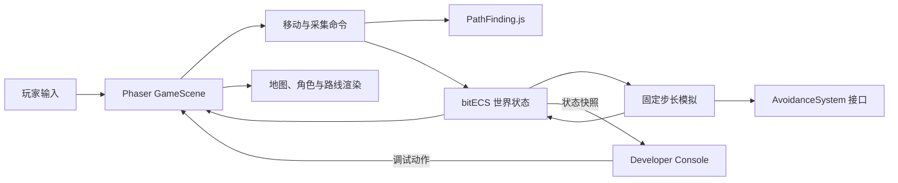

# 王国崛起 V0.1 当前开发总结

> 文档日期：2026-10-12  
> 项目阶段：V0.1 可交互原型  
> 目标平台：浏览器  
> 版本管理目标：GitHub（不使用 GitLab）

## 1. 项目概述

《王国崛起》当前是一个网页优先的 2D RTS 与领地经营原型。V0.1 的目标不是完成完整游戏，而是先验证以下基础链路是否成立：

1. 玩家能够选择和控制角色。
2. 角色能够在连续坐标地图上移动，并避开不可通行格。
3. 角色能够接受采集命令，自动完成“前往资源点—采集—送回仓库—继续采集”的循环。
4. 多个角色能够共享资源点和仓库，并保持资源数量正确。
5. 开发者能够快速观察、控制和复现游戏系统状态。

目前上述链路已经完成，可以作为后续建筑、生产、人口和避让系统的基础。

## 2. 当前完成情况

| 模块 | 状态 | 当前能力 |
| --- | --- | --- |
| 工程框架 | 已完成 | TypeScript、Vite、Phaser、Vitest，可开发、测试和生产构建 |
| ECS 数据层 | 已完成 | 使用 bitECS 保存角色、位置、生命、携带、移动命令和采集任务 |
| 地图系统 | 已完成 | 20×20 方格地图、障碍格、连续世界坐标、地图边界检测 |
| 角色选择 | 已完成 | 可选择领袖或居民，点击空白区域取消选择 |
| 手动移动 | 已完成 | 右键移动、准确抵达鼠标点击位置、障碍绕行 |
| 全局寻路 | 已完成 | 使用 PathFinding.js 进行四方向格子寻路 |
| 路径优化 | 已完成 | 空旷区域直线移动；有障碍时对格子路径进行可见性裁剪 |
| 资源采集 | 已完成 | 到达范围后采集，携带满后自动送仓并循环 |
| 多人采集 | 已完成 | 领袖和居民可同时采集同一资源点，共享资源和仓库容量 |
| 仓库 | 占位实现 | 固定位置、固定容量、接收资源、容量满后停止采集循环 |
| 路线显示 | 已完成 | 手动移动显示选中角色路线；采集往返路线默认隐藏 |
| Developer Console | 已完成 | 观察、控制、验证和诊断平台 |
| 避让系统 | 仅保留接口 | V0.1 使用直通实现，角色之间暂时可能重叠 |
| 存档、网络、正式美术 | 未实现 | 不属于当前 V0.1 范围 |

## 3. 技术方案

### 3.1 技术栈

| 技术 | 版本 | 用途 |
| --- | --- | --- |
| Phaser | 4.2.1 | 场景、输入、摄像机和 2D 渲染 |
| bitECS | 0.4.0 | 实体与组件状态管理 |
| PathFinding.js | 0.4.18 | 四方向网格寻路 |
| TypeScript | 6.0.2 | 游戏代码与类型检查 |
| Vite | 8.3.4 | 本地开发与生产构建 |
| Vitest | 4.1.11 | 核心规则自动化测试 |

当前没有为 Developer Console 引入额外 UI 框架，控制台使用原生 HTML、CSS 和 DOM 实现。

### 3.2 模块关系



核心规则位于 `src/core`，不依赖 Phaser 或 DOM；场景和 Developer Console 位于 `src/presentation`。这样核心移动、采集和资源规则可以在不启动浏览器的情况下测试。

### 3.3 主要目录

```text
src/
├─ core/
│  ├─ commands/       移动与采集命令
│  ├─ config/         游戏参数
│  ├─ ecs/            世界、实体与组件
│  ├─ map/            地图、坐标和寻路适配
│  └─ simulation/     AvoidanceSystem 接口
├─ presentation/
│  ├─ debug/          Developer Console
│  └─ scenes/         Phaser 游戏场景
└─ main.ts            浏览器入口
tests/                核心规则测试
```

## 4. 移动与寻路

### 4.1 坐标规则

- 地图仍使用方格描述障碍和建筑占地。
- 角色位置和鼠标目标使用连续世界坐标。
- 点击非格子中心时，最终终点仍是鼠标点击位置，不会被强制吸附到格子中心。
- 建筑物、资源点和仓库可以继续使用整格占地。

### 4.2 路径规则

1. 目标点不可通行时，移动命令直接拒绝。
2. 起点到终点之间没有障碍时，角色沿直线移动。
3. 存在障碍时，PathFinding.js 先计算四方向格子路径。
4. 路径随后进行视线裁剪，减少不必要的直角转折。
5. 最后一个路径点使用准确的鼠标点击坐标。

这已经解决了早期“先沿 X 轴走，再沿 Y 轴走”的机械折线路径问题。

### 4.3 路线可视化

- 玩家手动控制当前选中角色移动时，显示该角色路线。
- 采集任务产生的自动往返路线默认不显示。
- Developer Console 可以强制显示选中角色或全部角色的路线，包括采集路线。
- 移动命令通过 `manual` 和 `task` 标记来源，寻路执行与路线显示互不依赖。

## 5. 资源采集系统

### 5.1 玩家操作流程

1. 左键选择领袖或居民。
2. 左键点击资源点。
3. 角色自动寻找资源点旁边的可通行位置。
4. 进入采集范围后开始工作。
5. 达到携带上限后前往仓库。
6. 到达仓库范围后将资源放入仓库。
7. 如果资源未耗尽且仓库未满，角色继续下一轮采集。

手动下达移动命令会取消该角色当前的采集任务。

### 5.2 采集任务状态

```text
moving-to-resource
        ↓
    gathering
        ↓
moving-to-warehouse
        ↓
  ┌───────────────┬────────────────┐
  ↓               ↓                ↓
继续下一轮    warehouse-full   resource-empty
                                   
任一移动阶段无法获得路径 → blocked
```

### 5.3 当前默认参数

| 参数 | 当前值 |
| --- | ---: |
| 初始资源量 | 60 |
| 单个角色携带上限 | 10 |
| 采集速度 | 5/秒 |
| 交互范围 | 1.1 |
| 仓库容量 | 30 |
| 模拟频率 | 20 Hz |
| 移动速度 | 4 格/秒 |

### 5.4 多人共享规则

- 多个角色可以同时采集同一个资源点。
- 资源扣减不会小于 0。
- 仓库库存不会超过容量。
- 一个角色装满仓库后，其他正在采集或运送的角色会停止任务。
- 角色之间目前没有分离避让，因此可能出现位置重叠，但不会穿越地图障碍。

## 6. Developer Console

Developer Console 已从简单信息面板升级为游戏调试与场景验证平台。

### 6.1 观察

- 实时 FPS、模拟 Tick、居民数量和活动路线数量。
- 查看所有角色、资源点和仓库的实体编号、坐标和状态。
- 查看生命、携带量、移动命令来源和剩余路径节点。
- 查看资源余量和仓库库存。
- 每 100 毫秒刷新一次调试快照，避免每帧大量更新 DOM。

### 6.2 控制

- 暂停或继续模拟。
- 暂停状态下单步执行 1 个固定模拟 Tick。
- 设置 0.25×、0.5×、1×、2× 或 4× 模拟速度。
- 在运行时生成新居民并自动选择。
- 一键向全部角色下达采集命令。
- 开启地图编辑模式后，左键点击地图格增加或移除障碍。
- 无需刷新页面即可恢复初始世界。

地图修改会取消当前活动命令，避免角色继续使用已经失效的旧路线。资源点、仓库和角色正在占用的格子不能被修改。

### 6.3 验证场景

| 场景 | 验证目标 |
| --- | --- |
| 双人采集 | 验证多人共享资源、携带和仓库循环 |
| 障碍绕路 | 验证 PathFinding.js 绕过中部障碍墙并抵达目标 |
| 仓库边界 | 将仓库设置为仅剩 5 容量，验证并发交付不会超容 |
| 完全阻断 | 生成贯穿地图的障碍墙，验证不可达移动命令会被拒绝 |

每次加载验证场景前都会恢复初始状态，因此能够重复复现，不需要手动刷新和重新操作。

### 6.4 系统诊断

控制台按模块展示状态，方便判断问题属于哪一层：

- `ECS`：实体与居民数量。
- `Command`：当前采集任务数量。
- `PathFinding`：活动路线和阻塞任务数量。
- `Simulation`：暂停状态、模拟倍速和固定更新频率。
- `Collision`：是否存在位于不可通行区域的角色。
- `Render`：Phaser 角色视图数量是否与 ECS 状态一致。
- `事件流`：记录命令接受/拒绝、场景验证、地图修改和世界重置。

## 7. 自动化验证结果

当前共有 5 个测试文件、15 项测试，覆盖：

- 地图边界、障碍编辑和四方向邻居。
- 四方向寻路、不可达目标和移动完成。
- 连续坐标移动、直线移动和准确鼠标终点。
- 单人采集循环和仓库满载。
- 双人采集同一资源点时的资源、仓库和障碍约束。
- 动态生成和移除居民时的 ECS 数据同步。

最近一次验证结果：

```text
npm run test       15 passed
npm run typecheck  passed
npm run build      passed
```

生产构建目前仍会提示 Phaser 主包大于 500 kB。这是体积警告，不影响当前原型运行；V0.1 暂不为此拆分代码。

## 8. 操作说明

### 8.1 游戏操作

- 左键角色：选择角色。
- 左键空白区域：取消选择。
- 选中角色后左键资源点：开始采集。
- 选中角色后右键地图：取消采集并手动移动。
- 按住鼠标中键：拖动地图。
- 鼠标滚轮：缩放地图。

### 8.2 开发命令

```bash
npm install
npm run dev
npm run test
npm run typecheck
npm run build
```

## 9. 已知限制

以下能力尚未完成，不应视为当前版本缺陷：

1. `AvoidanceSystem` 目前为直通实现，角色之间不会主动分离避让。
2. 只有一种资源和一个资源点，仓库也是占位建筑。
3. 没有建筑放置、建造过程、生产队列和人口系统。
4. 没有多选、编队、框选和群体移动阵型。
5. 没有存档、网络同步和服务端逻辑。
6. 没有正式角色动画、音效和美术资源。
7. 地图障碍改变后不会为旧命令动态重算路线，而是取消旧命令。
8. Developer Console 的事件和场景状态不会跨页面刷新保存，也不支持回放或导出。

## 10. 后续建议

### V0.1 后续补全

1. 增加建筑占地预览和仓库正式放置流程。
2. 支持多个资源点，并为采集命令明确目标资源类型。
3. 增加资源耗尽、仓库满载和路径阻断的游戏内反馈。
4. 为 Developer Console 增加更多业务场景，但只在出现稳定复现需求时添加。

### V0.2 移动与避让

1. 优先验证 Yuka 或自行实现简单分离避让。
2. 继续保留独立 `AvoidanceSystem` 接口，避免替换避让方案时改动命令和 ECS。
3. 根据实际单位规模再决定是否引入 ORCA、Flow Field 或 NavCat。
4. 在引入避让后补充拥堵、窄路和多人到达同一资源点的验证场景。

## 11. 当前结论

项目已经从“只能显示地图和单个角色”的工程框架，推进到可以实际验证 RTS 基础循环的 V0.1 原型：角色能够选择、移动、绕障、采集、运输和多人协作，开发者也能够在不修改代码和刷新页面的情况下复现关键场景。

下一阶段可以在现有核心接口上继续开发建筑与经营系统，同时将 V0.2 的重点放在多单位避让和更大规模的移动验证上。
